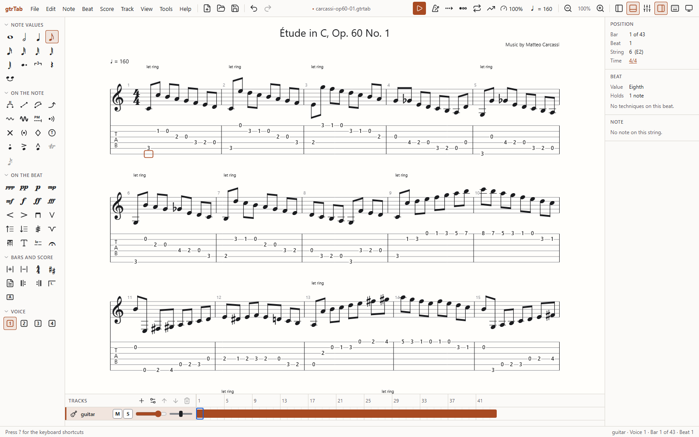
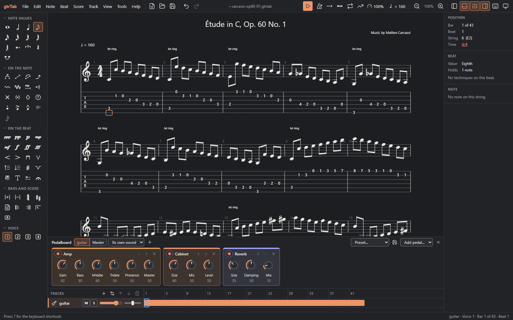
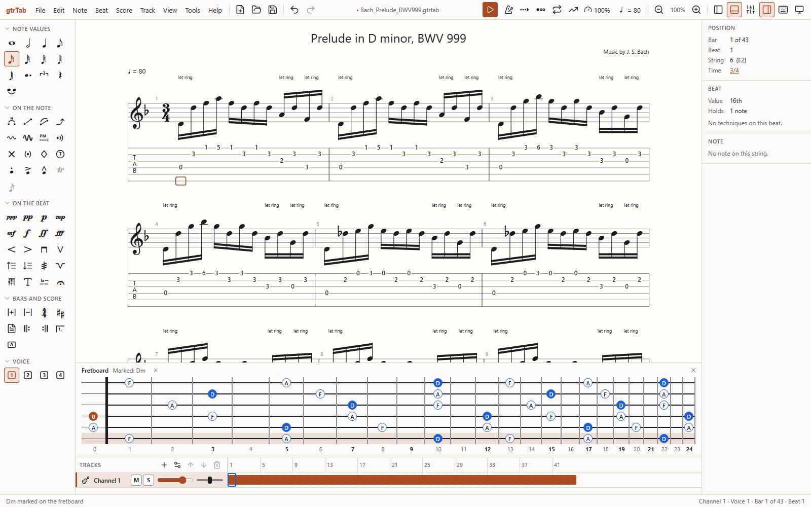
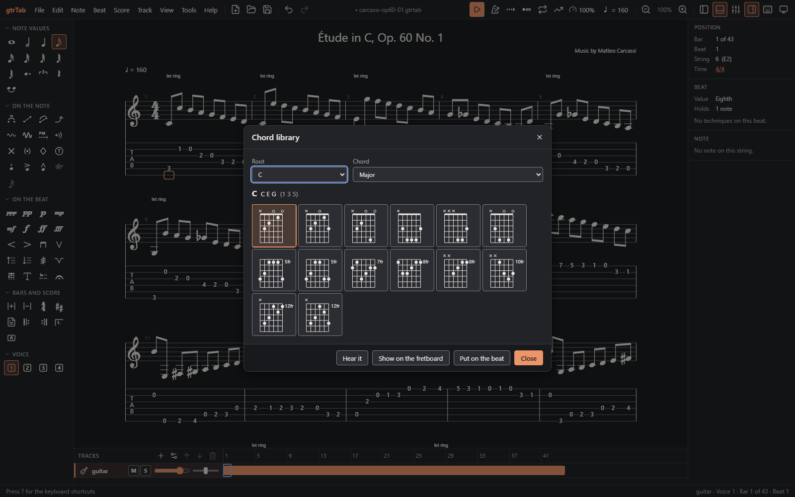

# gtrTab

A free guitar tablature editor. Write tab and standard notation together, hear it played back through a full pedalboard, and practise with it, on Windows, macOS and Linux.



## Download

Get the installer for your system from the [latest release](../../releases/latest):

| System | File |
|---|---|
| Windows | `gtrTab_<version>_x64-setup.exe` |
| macOS (Intel and Apple silicon) | `gtrTab_<version>_universal.dmg` |
| Linux | `.AppImage`, or the `.deb` or `.rpm` for your distribution |

The installers are not signed yet, so each system warns you the first time you open gtrTab:

- **Windows:** if Windows says it protected your PC, choose **More info**, then **Run anyway**.
- **macOS:** drag gtrTab to Applications and open it. When macOS refuses, go to **System Settings › Privacy & Security** and choose **Open Anyway**.
- **Linux:** make the AppImage executable (`chmod +x`) before running it.

## Features

### Write

- **Tab and notation together.** Type frets on the tab and the notation is written for you. Show a track as tab and notation, tab only, notation only, or rhythm slashes.
- **Every technique a guitarist needs:** bends and whammy bar dives drawn on a curve, slides, hammer-ons and pull-offs, harmonics, vibrato, palm muting, let ring, tapping, dead and ghost notes, trills, tremolo picking, grace notes, rasgueado, and slap and pop for bass.
- **Keyboard or mouse.** Drag across beats to select them, double-click for a bar and triple-click for a line, Shift+click to extend, or drag along a track's bars in the track pane; Ctrl+A selects everything.
- **Whole songs and bands.** Guitars of any tuning with a capo, bass, drums and piano, each on its own track, with up to four voices on a staff.
- **The rest of the score:** repeats and alternate endings, segno, coda and fine, sections, tempo and key changes, dynamics, chord names and diagrams, lyrics and text. Playback follows the repeats and jumps.

### Hear it

- **Realistic playback** through the GeneralUser GS SoundFont, with a mixer for each track's volume, pan, mute and solo, and playback slowed down or sped up without changing the pitch.
- **A pedalboard for every track and for the whole mix:** compressor, wah, overdrive, distortion, amp, cabinet, EQ, chorus, delay and reverb, from presets or dialled in by hand. A track can switch to another sound part-way through a song, say from clean to driven for the chorus.
- **Plug in and play.** Line in puts your own guitar through the same pedals.



### Practise

- **Loop a passage** and use the **speed trainer** to bring it up to tempo a step at a time.
- **See where the notes are** on a fretboard, a piano keyboard or a drum kit under the score as it plays, with a visual metronome alongside.
- **Play along with a recording.** Add an audio track, line its bars up with the music, and it slows down and speeds up with the score.
- **A tuner, a chord library and a scale library**, and a scale finder that tells you which scales fit the notes you have written.





### Share

- **Opens** Guitar Pro files of every version (`.gp3`, `.gp4`, `.gp5`, `.gpx`, `.gp`), MusicXML, MIDI, and tab typed as plain text, by File › Open or by dropping them on the window.
- **Exports** to Guitar Pro (`.gp`), MusicXML, MIDI, plain-text tab, PDF, PNG, SVG and WAV audio, and prints.
- **Converts a whole folder at once** with batch conversion.

### Make it yours

- Light and dark themes, a high-contrast mode, and the score on white paper whatever the theme.
- The score as printed pages, one long sheet, or a single line that scrolls sideways, with a stylesheet for sizes and spacing, and a design mode for choosing the line and page breaks yourself.
- Every command can be found by name in the command palette (Ctrl+K), and any of them can be given a keyboard shortcut of your choice. Press **?** in the app to see them all.

## For developers

gtrTab is a Rust core (score model, editing, layout, file formats and the synth) compiled to WebAssembly, with a Svelte interface. The desktop app wraps it in [Tauri](https://tauri.app); the same interface also runs as a web app in the browser.

### Requirements

- Rust (stable) with the `wasm32-unknown-unknown` target
- Node.js 22 or later
- On Windows, the Windows SDK, for the desktop app's resources. If the build cannot find `rc.exe`, build from a Developer PowerShell for Visual Studio or point the `RC` environment variable at it.

### Building and testing

Install dependencies once, and fetch the SoundFont (too big for the repository; without it the app plays through its built-in models):

```sh
cd app/ui && npm install && npm run soundfont
cd ../desktop && npm install
```

| Task | Command | Run from |
|---|---|---|
| Core tests, and the TypeScript types generated from Rust | `cargo test` | repo root |
| Lint | `cargo clippy --all-targets -- -D warnings` | repo root |
| Web app (dev server) | `npm run dev` | `app/ui` |
| Web app (production build) | `npm run build` | `app/ui` |
| Type-check the UI | `npm run check` | `app/ui` |
| Unit tests of the UI's plain functions | `npm test` | `app/ui` |
| End-to-end tests, of the production build | `npm run build`, then `npm run e2e` | `app/ui` |
| Desktop app (dev) | `npm run dev` | `app/desktop` |
| Desktop app (installers) | `npm run build` | `app/desktop` |

The end-to-end tests need Playwright's browser once: `npx playwright install chromium` in `app/ui`. The notation is also tested against pictures in `tests/golden`; when a change to the engraving is meant, look at the new pictures in `target/golden`, then run `GTR_BLESS=1 cargo test -p gtr-render` and commit them.

To see what an importer and the layout make of a file without opening the app, draw it: `cargo run -p gtr-render --example draw -- song.gp5 song.png` writes a PNG, a PDF or an SVG by the name it is given, and takes `tab`, `standard`, `both` or `slash` and `all` for the view.

The interface's types for the score, the editor's state and the laid-out page are generated from the Rust ones into `app/ui/src/lib/generated` whenever the tests run. Commit them with the change that altered them; CI fails if they are out of date. CI runs only when started by hand, from the Actions tab, so run the tests, `cargo clippy` and `cargo fmt --check` before pushing.

The UI scripts rebuild the WASM core into `app/ui/src/wasm` before starting: the editor through `wasm-pack`, and the synth for the audio thread (`crates/gtr-worklet`) with a plain `cargo build`.

### Releasing

Set the version in the root `Cargo.toml`, then push a tag of the same version, such as `v0.1.0`. The Release workflow builds the installers for every system and puts them on a draft release to check and publish.

### Project layout

- `crates/`: the Rust core: score model, editor, notation and tab layout, playback, file formats and the WASM API.
- `app/ui/`: the Svelte interface shared by the web and desktop apps.
- `app/desktop/`: the Tauri shell.
- `tests/`: files in other formats that the importers are tested against, and the pictures the notation is compared with.

## Third-party assets

- `app/ui/public/fonts/Bravura.woff2` and `Bravura.otf`: the Bravura music font by Steinberg, under the SIL Open Font License (`Bravura-OFL.txt` alongside it).
- `app/ui/public/fonts/NotoSans-*.ttf`: Noto Sans, the text font of exported PDFs and pictures, under the SIL Open Font License (`NotoSans-OFL.txt` alongside it).
- The GeneralUser GS SoundFont by S. Christian Collins, which the app plays through and the releases ship with, under its own licence (fetched with it as `GeneralUser-GS.LICENSE.txt`). It is not kept in the repository.
- Interface icons from [Lucide](https://lucide.dev) (`@lucide/svelte`), under the ISC License. Music symbols in the interface are Bravura glyphs; the guitar technique icons are drawn in `app/ui/src/lib/ui/icons.ts`.
- `tests/corpus/`: files in other programs' formats that the tests import, used by the tests only: Guitar Pro and MusicXML files from the test data of [alphaTab](https://github.com/CoderLine/alphaTab), under the Mozilla Public License 2.0; the unofficial MusicXML test suite by Reinhold Kainhofer, under the MIT licence; and public-domain MIDI files from the [Mutopia Project](https://www.mutopiaproject.org/). `tests/corpus/README.md` says which came from where, and each licence is alongside its files.
- The pieces in the screenshots are in the public domain: Matteo Carcassi's Étude Op. 60 No. 1 and J. S. Bach's Prelude BWV 999, from the Mutopia Project.

## Trademarks

Guitar Pro is a trademark of Arobas Music. gtrTab is not affiliated with or endorsed by Arobas Music; it reads and writes Guitar Pro files so that scores can be moved between the two.
